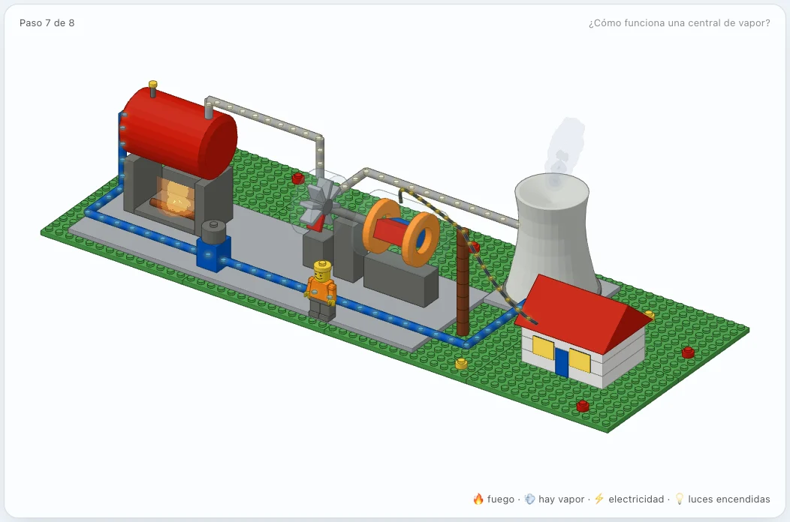
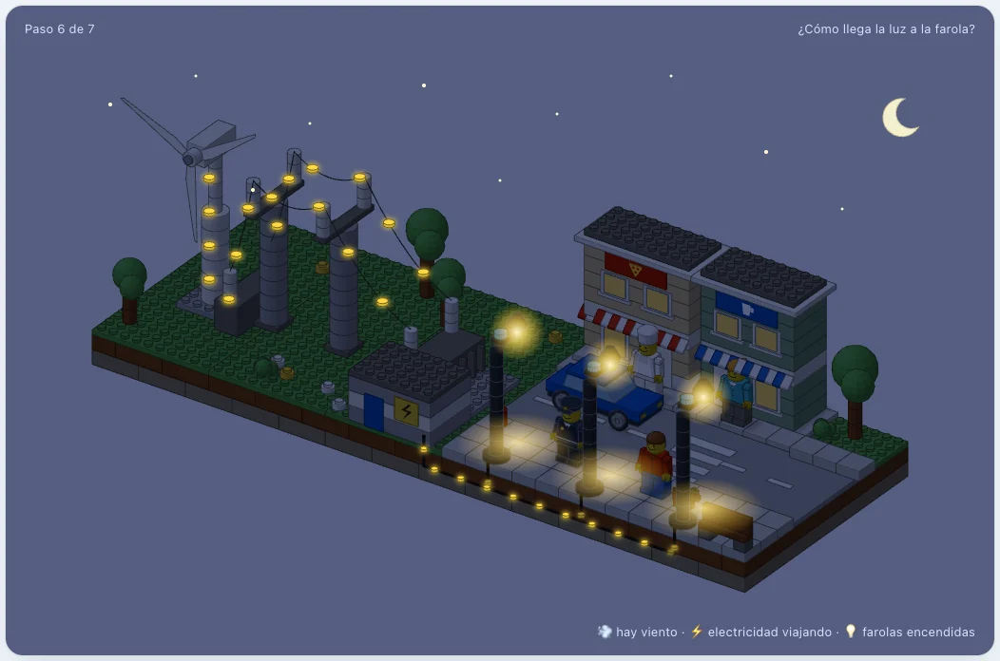
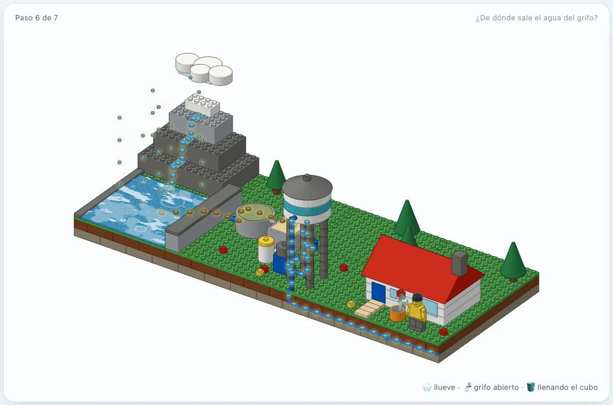
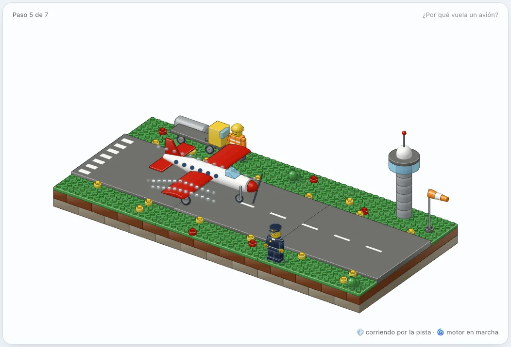
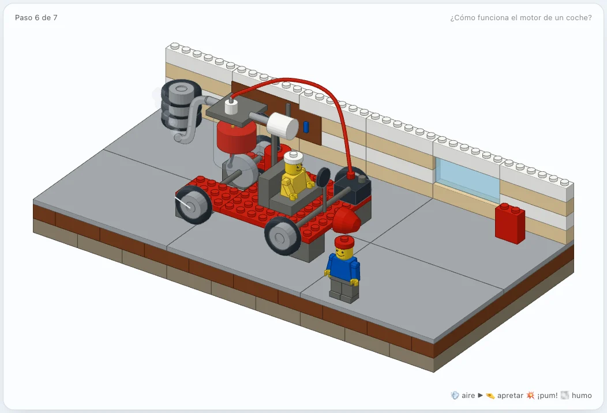
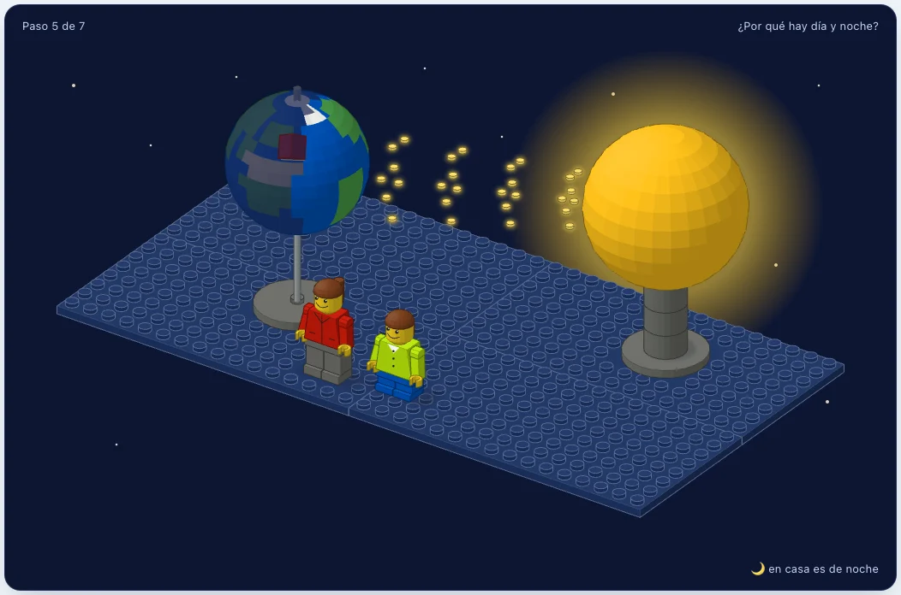

<h1 align="center">LEGO: lecciones para peques</h1>

<p align="center"><b>Una skill de Claude Code que explica a niños que aún no leen cómo funciona el mundo,<br>construyéndolo como una escena LEGO City que se monta paso a paso mientras un adulto cuenta la historia.</b></p>

<p align="center">
  
</p>
<p align="center"><sub><code>examples/vapor</code>: «¿Cómo funciona una central de vapor?», paso 7 de 8.</sub></p>

---

Tu peque pregunta «¿cómo llega la luz a las farolas?» y tú le pides a Claude:

```text
/lego ¿cómo llega la luz a las farolas?
```

Claude inventa una escena LEGO que **funciona** como aquello que se explica y hace visible lo invisible con piezas: la electricidad son piececitas amarillas que viajan por los cables, el agua son piezas azules y el aire, piezas blancas. Luego genera una página web que se abre en el navegador, sin instalar nada, donde la escena se construye **paso a paso, como un folleto de instrucciones**: en cada paso caen en su sitio las piezas nuevas y aparece una idea más.

Está pensada para **un adulto y un niño de 3 a 6 años sentados juntos delante del ordenador**. El niño no lee: mira, señala, contesta y toca. Para el adulto, cada paso trae tres textos:

- **Dile**: lo que puede decir en voz alta, en dos frases.
- **Pregúntale**: una pregunta que se contesta mirando el dibujo («¿Cuántas torres ves?») o una predicción («Si se para el molino… ¿qué le pasa a la farola?»).
- **Para mamá o papá**: la explicación de verdad, con datos reales, y cada simplificación de la historia dicha como tal.

El último paso siempre es **juego libre**: el niño provoca causas y ve sus efectos. Para el viento y la farola se apaga; apaga el fuego y la casa se queda a oscuras; sube demasiados pasajeros y el avión no despega.

## Galería

<table>
  <tr>
    <td width="50%"></td>
    <td width="50%"></td>
  </tr>
  <tr>
    <td><sub><b>¿Cómo llega la luz a la farola?</b> Del molino a la farola por torres, transformador y cable enterrado. Las farolas se encienden de noche con su «ojito».</sub></td>
    <td><sub><b>¿De dónde sale el agua del grifo?</b> Lluvia, embalse, depuradora (las piezas entran marrones y salen azules), bomba, depósito y grifo.</sub></td>
  </tr>
  <tr>
    <td></td>
    <td></td>
  </tr>
  <tr>
    <td><sub><b>¿Por qué vuela un avión?</b> La hélice empuja el aire y las alas lo desvían hacia abajo. Con demasiados pasajeros no le da la pista.</sub></td>
    <td><sub><b>¿Cómo funciona el motor de un coche?</b> Los cuatro tiempos dentro de un cilindro de cristal: «¡aire, apretar, pum, humo!».</sub></td>
  </tr>
  <tr>
    <td></td>
    <td></td>
  </tr>
  <tr>
    <td><sub><b>¿Por qué hay día y noche?</b> La Tierra de ladrillo gira de verdad junto al Sol y, cuando nuestra casa pasa a la sombra, se le encienden las ventanas. Se puede girar con el ratón.</sub></td>
    <td><sub><b>¿Cómo funciona una central de vapor?</b> Fuego, caldera, turbina, generador y casa, con el agua que da vueltas y vuelve a empezar.</sub></td>
  </tr>
</table>

## Instalación

Necesitas [Claude Code](https://code.claude.com), Node.js 20.10 o posterior y, solo para las comprobaciones, Chrome o Chromium.

```sh
git clone git@github.com:jrramon/anatomy-lego.git
ln -s "$PWD/anatomy-lego" ~/.claude/skills/lego
```

Reinicia Claude Code y la skill aparecerá como `/lego`. No hace falta `npm install`: el kit solo usa módulos de Node.

## Uso

```text
/lego ¿por qué flotan los barcos?
/lego explícale a mi hija de 4 años cómo late el corazón
/lego ¿cómo llega la basura a la planta de reciclaje?
```

También se activa sin la barra cuando preguntas cómo explicarle algo a un niño «con LEGO», o con preguntas infantiles del tipo «¿cómo llega…?» o «¿por qué…?». Claude escribe la lección en `examples/<nombre>/build.mjs`, la genera, la comprueba y te la abre en el navegador.

Cada página es un único archivo HTML, sin dependencias, que funciona sin conexión. En la página:

- **◀ ▶** o las flechas del teclado cambian de paso.
- Los botones de cada lección son las causas del juego libre: soplar viento, abrir el grifo, echar leña…
- Con `?paso=N` en la dirección, la página abre directamente en ese paso.

## Las lecciones de ejemplo

| Lección | Qué enseña del kit |
|---|---|
| [`examples/farola`](examples/farola) | Flujos que dependen del día y la noche; un cable visto en el corte de tierra |
| [`examples/agua`](examples/agua) | Tuberías, piezas que cambian de color por el camino, agua con brillos y lluvia |
| [`examples/avion`](examples/avion) | Un vehículo que se mueve por la escena con su propio aire; un modelo físico con un caso que falla a propósito |
| [`examples/motor`](examples/motor) | Un mecanismo por dentro: pistón, biela y válvulas movidos por un solo ángulo; llama y humo |
| [`examples/dia-noche`](examples/dia-noche) | Una pieza que gira de verdad, iluminada por un Sol de la escena |
| [`examples/vapor`](examples/vapor) | Todos los kits a la vez: fuego, giro, piezas redondas, cables y un circuito cerrado |
| [`examples/barco`](examples/barco) | Algo medio sumergido: un barco que flota en un puerto visto en corte, y una fuerza que el niño provoca empujándolo |

Cada una se genera con `node examples/<nombre>/build.mjs`, que escribe la página junto al script. Con `--audit` comprueba además la geometría.

## Cómo funciona

[`SKILL.md`](SKILL.md) le dice a Claude cómo pensar una lección: primero la verdad, luego la historia en 5-8 pasos con una idea cada uno, lo invisible hecho pieza, un modelo pequeño de causas y efectos, la escena en la rejilla de *studs*, y una comprobación como un crítico.

Debajo hay un kit en JavaScript que dibuja piezas LEGO con sus medidas reales (un *stud* mide 8 mm y un ladrillo, 9,6) en perspectiva isométrica, con el sombreado de los folletos de instrucciones:

| Kit | Para qué |
|---|---|
| `kit/brick.mjs` | Ladrillos, placas, *tiles*, rampas, tuberías y piezas a medida; el orden de pintado |
| `kit/lego-round.mjs` | Cúpulas, conos, bolas, platos, ruedas y piezas torneadas |
| `kit/lego-tube.mjs` | Mangueras, cables y tubos curvos |
| `kit/lego-figure.mjs` | Minifiguras de pie o sentadas, con oficio: cocinero, policía, obrero, niños… |
| `kit/lego-city.mjs` | LEGO City listo para usar: carreteras con paso de cebra, tiendas con toldo, árboles, mobiliario, coches y perros |
| `kit/lego-spin.mjs` | Piezas que giran de verdad, con día y noche |
| `kit/lego-fx.mjs` | Agua, fuego y humo con WebGL (sin WebGL, la lección sigue completa) |
| `kit/lego-audit.mjs` | Comprueba que ninguna pieza atraviesa a otra, flota o aparece antes que lo que la sujeta |
| `kit/lesson.mjs` | La página: pasos, textos para el adulto, botones y lo que viaja por la escena |

La referencia completa está en [`references/kit.md`](references/kit.md).

**Comprobación.** Antes de dar una lección por buena, Claude:
- La captura paso a paso con `scripts/capture.mjs`.
- Pulsa sus botones y comprueba cada causa y su efecto con `scripts/drive.mjs`, con y sin WebGL.
- Pasa la auditoría a cero.

La CI regenera y audita las siete lecciones en cada cambio.

## Limitaciones

- **Pensado para ordenador.** Las lecciones no están adaptadas a móvil y solo tienen tema claro.
- **Formas orgánicas, construidas con ladrillos.** Animales o un corazón realista salen «hechos de ladrillos»: es coherente con LEGO, pero no hay piezas de animales.
- **Sin brazos articulados.** No hay mecanismos con muchas articulaciones encadenadas, como una mano que coge algo. Un engranaje con dientes se puede hacer con `lego-spin`, aunque la primera vez habrá que construir la pieza.
- **Cada lección tarda un rato.** Generarla, comprobarla y pulirla lleva su tiempo, y a menudo amplía el kit con algo nuevo, que luego queda para las siguientes.

## Origen y licencia

Este proyecto es un fork de [**Anatomy**](https://github.com/wheresryan22/anatomy), una skill que explica ideas técnicas construyéndolas como máquinas isométricas. De él vienen el núcleo isométrico (`kit/iso-kit.mjs`) y las herramientas de captura. Licencia [MIT](LICENSE).

LEGO® es una marca registrada de The LEGO Group, que no patrocina, autoriza ni respalda este proyecto. Las lecciones son para uso personal y educativo: no reproducen el logotipo de LEGO ni deberían publicarse como productos oficiales.
